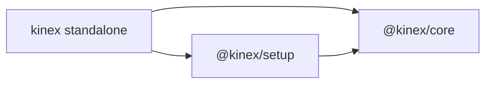

# Core and setup separation

`@kinex/core` provisions, registers, removes and operates devices. `@kinex/setup`
coordinates workspace onboarding and calibration. Core remains usable by itself,
including adding devices and repairing drivers.

Both packages support hardware and simulators and are independent of host agents
and UIs. Standalone includes both by default.

Setup imports core through package exports. Core never imports setup. Host
integration, approval UI, model providers and agent loops belong outside these
packages. Native plugins consume explicitly updated packed snapshots.

## Ownership

| Area | `@kinex/core` | `@kinex/setup` |
| --- | --- | --- |
| Commands | `/register`, `/unregister`, `/devices`, `/load`, `/unload`, `/reload`, `/ping`, `/stop`, `/record` | `/onboarding`, `/calibrate` |
| Model tools | `profile_write`, `device`, `devices`, `device_stop`, `skill`, operational Python tools, opt-in `record` | `setup_plan`, `calib_sample`, `calib_compute` |
| Devices | Registration, provisioning, drivers, connections, lifecycle, dispatch, scheduling and resource ownership | Uses core devices during onboarding and calibration |
| Geometry and control | Frames, transforms, URDF models, FK/IK, trajectories, perception and policy execution | Calibration routines, measurement procedures and evidence |
| Profiles | Schemas, storage, validated writes, calibration-request markers and readiness | Collects workspace facts and measured calibration results through core APIs |
| Assets | Complete device guides, driver templates, FastWAM/SAM3/GroundingDINO bundles, setup-device, runtime Python and operational tools | Calibration skills and scripts |
| Context | Device facts, guide roots, readiness details, frames, Use conventions, Python paths and recording state | Onboarding/calibration instructions and actionable calibration guidance |

Core retains all control utilities, including `servo`, `track`, `settled`,
`relative_pose`, `locate_object_3d` and `run_policy`. Calibration facts are shared
runtime data: core validates profiles and explicit marker clears even without
setup installed. Setup performs the procedures that obtain those facts.

## APIs and composition

| API | Responsibility |
| --- | --- |
| `createKinexRuntime(options)` | Creates the core runtime and owns its resource scope |
| `runtime.devices.templates()` | Discovers provisioning instances and type templates |
| `runtime.devices.unregister(name, signal?)` | Performs trusted deactivation and inventory deletion |
| `runtime.readiness()` | Reports profile completeness and prerequisite status without calibration procedures |
| `runtime.tools.call("profile_write", input, invocation)` | Writes validated workspace/device facts or calibration-request markers with host permission |
| `createKinexSetup(runtime)` | Creates a setup facade borrowing that runtime |
| `setup.plan.inspect()` | Reports task-scoped DAG progress and available procedures |
| `coreContribution(runtime)` / `setupContribution(setup)` | Expose features through the shared contribution interface |
| `composeContributions([...])` | Combines command/tool catalogs, skills and namespaced context |

Setup has no device facade. Core's `/register` workflow and setup-device skill use
`profile_write` and dynamic readiness details, so registration does not require
calibration tools. Registration leaves new devices unloaded; activation uses
`/load` or the permission-checked device tool.

Composition is explicit. A host enabling setup supplies `setupSkillRoots` as
core's `builtinSkillRoots` and `setupToolNames` as `reservedToolNames`, then composes
both contributions. Setup roots contain only calibration skills; setup-device is
always a core builtin. Discovery scans project/global roots once and preserves
overrides. Duplicate contribution identifiers are errors. See the
[composition example](packages/setup/README.md#composition).

## Execution and lifecycle

Construction is inert. The host owns one core runtime and calls `runtime.dispose()`
on workspace shutdown. Setup has no independent connections, Python environment or
disposal lifecycle. Its operations use `runtime.operation()` and tools use
`runtime.tools.execute()` for shared scope, cancellation, validation, invocation
callbacks and recording attribution.

URDF parsing is shared within the runtime. Each caller can cancel its own wait;
runtime disposal cancels the shared parser. Disposal cancels and waits for tracked
work, finalizes recordings and releases owned resources.

Trusted commands and model tools remain separate. `/unregister` confirms through
the host; `runtime.devices.unregister()` itself does not prompt. The operation
holds the per-device lifecycle fence through deactivation and deletion, preventing
concurrent load/reload from reopening the device. Required deactivation failures
preserve its files. Removal cleans up legacy per-device calibration-result files without importing
setup. New attempt history remains available; missing devices invalidate relevant
setup requirements. Borrowed services are never terminated as owned resources.

Core defaults `profile_write` permission to `allow`; setup exports
`setup_plan: allow` and `calib_compute: ask`. Explicit rules take precedence in the resolver, while
hosts retain their interaction policy. Missing callbacks deny requests except
stop. Profile-writing tools cannot change activation intent. Python tools cannot
change lifecycle; model recording stays opt-in.

## Assets, state and migration

Both packages preserve existing `.kinex` profiles and historical calibration records.
Setup adds `setup/plan.json` and isolated `calib/<run-id>/` evidence directories. Discovery preserves nearest project → ancestors →
global → packaged precedence, searching concrete instances before type templates.
Core device guides contain `Setup`, nested `Profile`, and `Use` sections together.
Only `Use` is injected for loaded device types; provisioning reads the other
sections on demand. Workspace/global overrides follow the same format.

Core owns lazy `.kinex/python` and runtime Python helpers. Setup scripts borrow
that environment or an explicit vendor interpreter. Ordinary host shells retain
their own Python environment. Provisioning copies drivers and support modules into
the device workspace or declared environment rather than linking packaged templates.

Consumers must replace `calib_write` calls with `profile_write` and migrate
`permission.calib_write` rules to `permission.profile_write`; there is no alias.
Replace `setup.devices.templates/unregister` with the corresponding runtime methods.
Registration's prompt lives in `@kinex/core/workflows/index`; setup exports only
onboarding and calibration workflows. Provisioning asset paths now belong to core;
workspace-local drivers require no migration.

## Delivery and validation

Build order remains core → setup → standalone. Packing produces three aligned npm
tarballs with exact internal dependencies; routine checks do not publish them.

Core tests cover provisioning, profile validation, permissions, guide discovery,
unregister fencing and operation without setup. Setup tests cover composition,
calibration, evidence, permissions and shared cancellation. Installed-package tests
verify core-only registration and operation, relocation, and continued operation
after setup is removed.

See [DESIGN.md](DESIGN.md), the [core API](packages/core/README.md) and the
[setup API](packages/setup/README.md) for detailed contracts.
