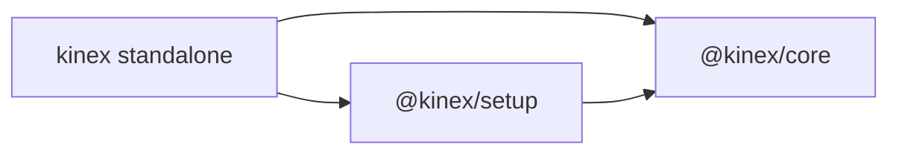

# Core and setup separation

`@kinex/core` operates a configured device inventory. `@kinex/setup` provides the
procedures and assets to prepare, calibrate, add or remove devices. Core remains
usable without setup installed, including all utilities needed for control.

Both packages support hardware and simulators and are independent of host agents
and UIs. The standalone `kinex` application includes both by default.

Setup imports core through its package exports. Core never imports setup. Host
integration, approval UI, model providers and agent loops belong outside these
two packages.

## Ownership

| Area | `@kinex/core` | `@kinex/setup` |
| --- | --- | --- |
| Commands | `/devices`, `/load`, `/unload`, `/reload`, `/ping`, `/stop`, `/record` | `/onboarding`, `/register`, `/unregister`, `/calibrate` |
| Model tools | `device`, `devices`, `device_stop`, `skill`; operational Python tools; opt-in `record` | `calib_plan`, `calib_write`, `calib_sample`, `device_calibrate` |
| Operation | Connections, dispatch, scheduling, lifecycle, stop and resource ownership | Provisioning and inventory-management procedures |
| Geometry and control | Frames, transforms, URDF resolution, FK/IK, trajectory planning, perception and policy execution | Calibration routines, measurement procedures and calibration records |
| Profiles | Schemas, storage, validated trusted writes and readiness evaluation | Guided profile creation, editing and calibration requests |
| Assets | Runtime Python helpers, operational tools and device `Use` conventions | Setup/calibration skills, `Setup/Profile` guides, starter drivers and provisioning bundles |
| Runtime context | Device facts, readiness, frames, conventions, Python paths and recording state | Setup instructions, guide roots and actionable calibration guidance |

Core's operational tools include `servo`, `track`, `settled`, `relative_pose`,
`locate_object_3d` and `run_policy`. A fixed inventory can still be loaded,
unloaded, reloaded, inspected, controlled and recorded through core.

Core also retains trusted profile-writing primitives. The boundary separates
shared runtime data and validation from setup procedures; it does not make core
read-only. In particular, core validates explicit calibration-marker clears even
when setup is absent. Runtime URDF parsing stays in core because normal kinematics
and recording depend on resolved models.

## APIs and composition

| API | Responsibility |
| --- | --- |
| `createKinexRuntime(options)` | Creates the core runtime and owns its resource scope |
| `runtime.readiness()` | Reports profile completeness and prerequisite status without procedural guidance |
| `createKinexSetup(runtime)` | Creates a setup facade borrowing that runtime |
| `setup.calibration.plan()` | Adds setup guidance to core's readiness checks |
| `setup.devices.templates()` | Discovers provisioning instances and type templates |
| `setup.devices.unregister(name, signal?)` | Performs trusted deactivation and inventory deletion |
| `coreContribution(runtime)` / `setupContribution(setup)` | Expose features through the shared contribution interface |
| `composeContributions([...])` | Combines command/tool catalogs, skills and namespaced context |

Composition is explicit; there is no dynamic package loader or global feature
registration. A host enabling setup supplies `setupSkillRoots` as core's
`builtinSkillRoots` and `setupToolNames` as `reservedToolNames`, then composes both
contributions. Reservations preserve setup builtin names ahead of discovered
custom tools. Duplicate identifiers across contributions are errors.

Skill discovery stays in core. Setup supplies its builtin skill root rather than
running a second workspace/global skill scan. Both the core skill tool and the
composed skill catalog therefore use the same overrides. See the
[composition example](packages/setup/README.md#composition).

## Shared execution and lifecycle

Construction is inert. The host owns one core runtime; setup has no independent
connections, Python environment or disposal lifecycle. The host initializes
devices as needed and calls `runtime.dispose()` on workspace shutdown.

Setup operations use `runtime.operation()` for scope, combined cancellation and
pending-operation tracking. Setup tool calls use `runtime.tools.execute()` for
schema validation, invocation callbacks, cancellation and recording events. Tool
implementations request permissions through those callbacks; the host decides
whether to allow them. Disposal cancels and waits for tracked work, finalizes
recordings and releases owned resources.
URDF parsing is shared within that runtime. Each caller can cancel its own wait;
runtime disposal cancels the shared parser, so cancelling setup work cannot fail
another caller's model lookup.

Trusted commands and model tools remain separate. The `/unregister` command asks
for confirmation; the trusted setup API itself does not prompt. Unregister holds
core's per-device lifecycle transition fence through deactivation and deletion,
so concurrent load/reload cannot reopen a device between those steps. Required
deactivation failures preserve the device files. Borrowed services are never
terminated as owned resources.

Setup exports permission defaults for `calib_write: allow` and
`device_calibrate: ask`; standalone passes them to core's permission resolver.
Explicit configured rules take precedence within that resolver, while the host
retains its interaction-mode policy. Missing permission callbacks deny requests.
Stop remains always allowed, Python tools cannot change device lifecycle, and
model recording remains opt-in.

## Assets and persistent state

Both packages use the existing `.kinex` workspace layout. Profiles and calibration
record formats are unchanged; setup does not create a second workspace database.
Content discovery preserves nearest project → ancestors → global → packaged
precedence. Bundled guides are split into core `Use` and setup `Setup/Profile`
content; combined workspace/global `DEVICE.md` overrides remain supported.

Core owns the lazy `.kinex/python` environment and runtime Python library.
Setup scripts use that environment or an explicitly configured vendor interpreter.
Ordinary host shells retain their own Python environment.

Provisioning copies drivers and required runtime support modules into the device
workspace or its declared environment. Configured drivers must not import or link
to files inside the installed setup package. This lets a configured inventory
continue operating after setup is uninstalled. Consumers referencing the old
packaged provisioning paths must copy those files and update their driver entry.

## Delivery and validation

The workspace builds core → setup → standalone and packs three npm tarballs with
aligned versions and exact internal dependencies. Native plugins in the separate
`kinex-plugins` project still consume their existing snapshots; adoption is explicit.

Architecture tests enforce package boundaries. Core tests exercise independent
operation; setup tests cover calibration, permissions, discovery and unregister
fencing. An installed-package test provisions a device, removes setup, then verifies
core-only lifecycle, recording, runtime conventions and URDF model resolution.

For detailed contracts, see [DESIGN.md](DESIGN.md), the
[core API](packages/core/README.md) and the
[setup API and migration guide](packages/setup/README.md).
