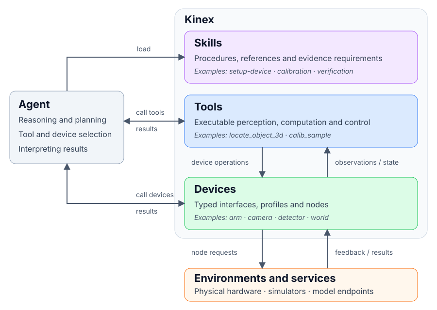

# Architecture

Kinex connects coding agents to physical robots and simulators through three layers:

- **Devices** expose typed interfaces to hardware, simulators and services.
- **Tools** execute operations that combine device access, computation and control.
- **Skills** guide the agent through tasks using reusable procedures.

The agent loads skills as needed, then calls devices directly through `device` or
`devices`, or uses tools that combine multiple operations. Both paths return
results to the agent and preserve the runtime's permission checks. The host owns
the agent loop, sessions and permission decisions.

A useful analogy is a coding-agent harness:

| Layer | Coding-agent analogy | Kinex example |
| --- | --- | --- |
| Devices | System resources such as disks and GPUs. OS and driver interfaces provide basic operations such as storage reads/writes or GPU computation. | Cameras, actuators and model services expose operations through drivers. |
| Tools | `bash` executes commands; `grep` searches text. These tools turn resource access into useful operations. | `locate_object_3d` combines camera and model outputs to estimate a position. |
| Skills | A debugging procedure guides the agent to reproduce a failure, inspect code, make a fix and run tests using available tools. | A calibration procedure guides sampling, computation and verification. |

In both cases, resources provide capabilities, tools execute operations, and
skills guide the agent's decisions. Coding tools normally access hardware through
OS interfaces and libraries rather than calling hardware drivers directly.

## Devices

A device is a named resource with a **type**, **profile** and **driver**. Its type
defines operations and data conventions; its profile describes access, intrinsic
properties and spatial relationships. The driver implements the interface using
a hardware SDK, simulator API or service connection, handling units, validation
and connection cleanup. Hardware and simulators share these contracts.

Examples include:

- A camera supplies images; a joint device accepts motion commands and returns
  measured state. Command acceptance does not establish arrival: verify feedback.
- A detection or policy model exposes inference as a device. Controller tools
  decide how to apply its output to the robot.
- A `world` device exposes environment time through `read` and `wait`, so tools
  can use the driver's clock for hardware or simulation.

See [device contracts](devices.md) for frames, motion and driver behavior.

## Tools

Tools are executable operations with names, descriptions and input schemas. They
perform computation or sequences of device calls without requiring the agent to
choose every intermediate step. Python tools declare their interface in
`tool.yaml` and implement it in `tool.py`, with two capability classes:

- **Perception** tools read and compute. For example, `locate_object_3d` combines
  camera imagery, a detection or segmentation model, and depth to estimate an
  object's position in the camera frame.
- **Controller** tools can also command devices and run feedback loops. For
  example, `servo` plans and submits a joint trajectory from measured state;
  it returns immediately by default, so arrival still requires feedback.

Python tools preserve permissions, cancellation and motion ownership; neither
class can load or unload devices. The agent-facing `device` tool and trusted user
commands provide lifecycle control. Other tools support profile updates and
calibration. See [agent integration](agent-integration.md) for host responsibilities.

## Skills

A skill is a discoverable `SKILL.md` containing task instructions, optionally
supported by references, scripts or procedure metadata. The agent loads it to
choose operations, interpret results and decide next steps. Loading a skill does
not execute the procedure or grant additional permissions.

For example, `setup-device` guides driver provisioning, profile creation and
interface verification. A camera calibration skill guides the agent to collect
observations through sampling tools, compute a calibration, and apply accepted
results through `profile_write`. The devices supply measurements, tools perform
the computation, and the skill specifies the procedure and required evidence.
See [setup and calibration](setup.md) for prerequisite and evidence contracts.

For package ownership, discovery and runtime lifecycle, see the
[project overview](overview.md).

[Design index](README.md)
