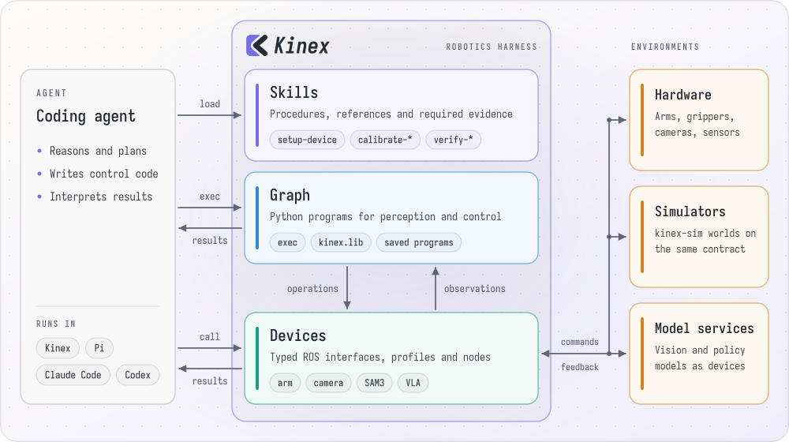

# Architecture

Kinex connects coding agents to physical robots and simulators through three layers:

- **Devices** expose typed interfaces to hardware, simulators and services.
- **Tools** execute operations that combine device access, computation and control.
- **Skills** guide the agent through tasks using reusable procedures.

The agent loads skills as needed, then calls devices directly through `device` or
`devices`, or runs Python programs through `exec`: written for the moment or saved
as files, and built from the function library.
These paths return results and selected images to the agent and preserve the
runtime's permission checks. The host owns the agent loop, sessions and permission
decisions.

A useful analogy is a coding-agent harness:

| Layer | Coding-agent analogy | Kinex example |
| --- | --- | --- |
| Devices | System resources such as disks and GPUs. OS and driver interfaces provide basic operations such as storage reads/writes or GPU computation. | Cameras, actuators and model services expose operations through device nodes. |
| Tools | `bash` executes commands; `grep` searches text. These tools turn resource access into useful operations. | `exec` runs Python with device access; a program can combine a camera image, a detector's boxes and depth to estimate a position. |
| Skills | A debugging procedure guides the agent to reproduce a failure, inspect code, make a fix and run tests using available tools. | A calibration procedure guides sampling, computation and verification. |

In both cases, resources provide capabilities, tools execute operations, and
skills guide the agent's decisions. Coding tools normally access hardware through
OS interfaces and libraries rather than calling hardware drivers directly.

## Devices

A device is a named resource with a type, a profile and a communication interface.
The type describes physical or computational facts: builtin types cover the world,
joint mechanisms such as arms and hands, grippers, suction tools, locomotion
bases, rgb and rgbd cameras, IMUs, force/torque sensors and models, with `other`
as the fallback. Its operation catalog declares arbitrary typed ROS topics and
services; nodes implement those interfaces through a hardware SDK, simulator API
or computational service. A device can start several owned nodes or expose a
subset of endpoints from an existing shared node. Core owns only the nodes
declared in that device's runtime; external nodes retain their own lifecycle.
Every workspace has a world device, which owns time. Hardware and simulators
share these contracts; [kinex-sim](https://github.com/stacx-lab/kinex-sim) runs
simulators as Kinex ROS graphs and exports their workspaces.

Examples include:

- A camera publishes images on ROS topics; a joint device takes motion commands
  and returns measured state. A sent command does not establish arrival: verify
  feedback.
- A detection or policy model exposes inference as a device through JSON
  services. Controller tools decide how to apply its output to the robot.
- A `world` device exposes environment time through its clock topic and its wait
  and stop services. Tools schedule work through these operations for hardware or
  simulation.

See [device contracts](devices.md) for frames, motion and node behavior.

## Tools

Tools are executable operations with names, descriptions and input schemas. They
perform computation or sequences of device calls without requiring the agent to
choose every intermediate step. The `exec` tool runs a complete Python program
with runtime access, given as source or as a saved file. A program can compose
perception and control functions, wait on the world clock, check measured
feedback in bounded loops, and end with `finish`, which returns a structured
result and the images it names. The agent interprets those observations before
choosing the next action.

The function library is the `kinex.lib` package: builtin modules plus the
workspace's `.kinex/lib`. A public function's signature and docstring are its
interface; no manifest or registration exists. Programs and library functions
reach devices through the invocation's one communication scope, `io`, with
`read`, `subscribe`, `publish`, `request` and `serve`, so functions call each
other as ordinary Python and ordinary branching and asyncio task groups define
the workflow. The agent browses the library level by level with the `lib` tool;
the user runs a saved program with `/exec`, without the agent. Perception and
control share one execution approval. An invocation's
temporary communication resources end with it; model state persists in devices.

`lib.frames` queries tf2; camera geometry comes from profile intrinsics or the
camera node's geometry services.

`exec` preserves permissions and cancellation, and a failed
invocation stops the devices it commanded; Python cannot load or unload devices.
Programs own their stopping conditions and must explicitly stop motion when
successful completion requires it.
The agent-facing `device` tool and trusted user commands provide lifecycle
control. Other tools support profile updates and calibration. See
[tools and skills](tools-and-skills.md) for execution guidance and
[agent integration](agent-integration.md) for host responsibilities.

## Skills

A skill is a discoverable `SKILL.md` containing task instructions, optionally
supported by references, scripts or procedure metadata. The agent loads it to
choose operations, interpret results and decide next steps. Loading a skill does
not execute the procedure or grant additional permissions.

For example, `setup-device` guides device node provisioning, profile creation and
interface verification. A camera calibration skill guides the agent to collect
observations through sampling tools, compute a calibration, and apply accepted
results through `profile_write`. The devices supply measurements, tools perform
the computation, and the skill specifies the procedure and required evidence.
See [setup and calibration](setup.md) for prerequisite and evidence contracts.

For package ownership, discovery and runtime lifecycle, see the
[project overview](overview.md).

[Design index](README.md)
